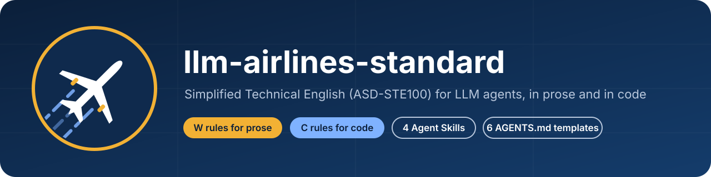

<p align="center">
  
</p>

<p align="center">
  <a href="https://github.com/maulanasdqn/llm-airlines-standard/actions/workflows/check.yml"></a>
  <a href="https://github.com/maulanasdqn/llm-airlines-standard/releases/latest"></a>
  <a href="LICENSE"></a>
</p>

# llm-airlines-standard

Aircraft maintenance manuals use a controlled language, so that no technician can misread an instruction.
That language is ASD-STE100 Simplified Technical English (STE).
This project applies the same discipline to LLM agents.

The project has three parts:

1. **STE for prose (W rules).** These rules apply to docs, commits, PRs, error messages, logs, and prompts that agents write.
2. **STE-C for code (C rules).** This port of STE applies to names, functions, files, errors, and logs.
3. **Tools.** One Rust binary, `ste`, checks prose and code, installs the skills, and sets up a repository. It has no runtime dependency. The project also has Agent Skills, AGENTS.md templates, and linter configs.

## Quick start

1. Install `ste` and the skills:

   ```sh
   curl -fsSL https://raw.githubusercontent.com/maulanasdqn/llm-airlines-standard/main/install.sh | bash
   ```

   On Windows, run this command in PowerShell:

   ```powershell
   irm https://raw.githubusercontent.com/maulanasdqn/llm-airlines-standard/main/install.ps1 | iex
   ```

2. Set up your repository:

   ```sh
   ste adopt --linters --hook
   ```

3. Check the prose and the code:

   ```sh
   ste check prose .
   ste check code .
   ```

## The code port in one table

| STE idea | STE-C rule |
|---|---|
| Use approved words, each with one meaning | Start each function with an approved verb. Each verb has one contract: `get` does no I/O, `fetch` uses the network (C3.1, C3.2). |
| Use one word for one meaning | Do not use `getUser`, `retrieveOrder`, and `obtainInvoice` in one codebase (C1.3). |
| Use 3 nouns or fewer in a cluster | Use 4 words or fewer in a name (C2.1). |
| Write 20 words or fewer in an instruction | Write 40 lines or fewer in a function (C5.1). |
| Write one topic per paragraph | Write one topic per file, in 200 lines of code or fewer (C5.7). |
| Put the condition first | Use guard clauses and early returns (C5.2). |
| Do not leave out words | Do not use magic numbers, implicit coercion, or positional booleans (C4.3). |
| Descriptive writing | Write no comments and no docstrings. The code explains itself (C6.1, C6.2). |
| Safety instructions | Put the risk in the name and give it a safe default: `deleteAllRows({ isConfirmed: false })` (C7.1, C7.2). |

The full rules are in `spec/writing/rules.md` and `spec/code/rules.md`.
The map of each STE section to its code rules is in `spec/code/mapping.md`.

## What is in this repository

| Path | Contents |
|---|---|
| `src/` | The Rust source of the `ste` binary |
| `skills/ste-writing` | A skill to write and rewrite prose with STE |
| `skills/ste-code` | A skill to write code with STE-C |
| `skills/ste-review` | A skill to audit prose and code with `ste check` |
| `skills/ste-adopt` | A skill to set up the standard in a repository with `ste adopt` |
| `templates/agents/` | Drop-in AGENTS.md files: `base`, `docs`, `typescript`, `python`, `go`, and `rust` |
| `templates/LEXICON.md` | The empty project dictionary |
| `linters/` | Configs for Vale, ESLint, ruff, golangci-lint, and clippy, and a git `commit-msg` hook |
| `spec/` | The rules, the dictionary, and the language profiles |
| `install.sh`, `install.ps1` | The installers for macOS and Linux, and for Windows: they download `ste`, then install the skills |
| `docs/images/` | The logo, the build diagram, and the source of the plugin icon |
| `tests/` | The Rust tests and the fixtures |
| `tools/verify_linters.sh` | A script that runs each linter on the test fixtures |

The build reads the rules in `spec/` and writes the skills, the templates, and the linter configs.
The `ste` binary embeds all of them. The installer and `ste adopt` put them in your repository.


## The ste command

| Command | What it does |
|---|---|
| `ste check prose PATH...` | Find breaks of the W rules in Markdown and text files. |
| `ste check code PATH...` | Find breaks of the C rules in TypeScript, JavaScript, Python, Go, and Rust files. |
| `ste check commit FILE` | Find breaks of rule C9.4 and the W rules in a commit message. Use `-` for the standard input. |
| `ste check lexicon PATH...` | Write a draft `LEXICON.md` from the names in the code. |
| `ste install` | Install the skills for Claude Code, Codex, Cursor, and other agents. |
| `ste adopt` | Write `AGENTS.md`, `CLAUDE.md`, `LEXICON.md`, the linter config, and a commit hook in a repository. |
| `ste build` | Write the generated files of this repository from `spec/`. This command is for maintainers. |

Run `ste --help` or `ste <command> --help` to see all the options.

## Install

### The installer

The installer downloads the `ste` binary for your platform and checks its SHA-256.
Then it asks which skills you want and where to put them.
Run it from the project where you want the skills.

On macOS and Linux, run this command. It needs only `bash`, `curl`, and `tar`:

```sh
curl -fsSL https://raw.githubusercontent.com/maulanasdqn/llm-airlines-standard/main/install.sh | bash
```

On Windows, run this command in PowerShell:

```powershell
irm https://raw.githubusercontent.com/maulanasdqn/llm-airlines-standard/main/install.ps1 | iex
```

| Installer | Folder of `ste` | Options |
|---|---|---|
| `install.sh` | `~/.local/bin` | `--binary-only` installs only `ste`. The other options go to `ste install`. |
| `install.ps1` | `%LOCALAPPDATA%\Programs\ste` | `-BinaryOnly` installs only `ste`. `-AddToPath` adds the folder to the Path of your user account. |

To use a different folder, set `STE_INSTALL_DIR`.
Release builds exist for macOS (Apple silicon and Intel), Linux (x86_64 and arm64), and Windows (x86_64).
Windows on ARM runs the x86_64 build with emulation.

The installer shows two menus:

```text
Which skills do you want to install?
  1) ste-adopt: Set up STE (ASD-STE100 Simplified Technical English) and STE-C (its port to code) in a repository.
  2) ste-code: Write, refactor, or review source code with STE-C, the port of ASD-STE100 Simplified Technical English to code.
  3) ste-review: Audit prose or code against STE (the ASD-STE100 writing rules) and STE-C (the code port), and report each break with its rule ID.
  4) ste-writing: Write or rewrite prose with the ASD-STE100 Simplified Technical English rules, so that no reader can misread it.
Type numbers, or press Enter for 1, 2, 3, 4: 2 4
Where do you want to install them?
  1) Claude Code, for your user account (~/.claude/skills)
  2) Claude Code, for the current project (.claude/skills)
  3) Codex, Cursor, and other agents, for your user account (~/.agents/skills)
  4) Codex, Cursor, and other agents, for the current project (.agents/skills)
  5) Another folder (you type the path)
Type numbers, or press Enter for 1: 1 3
```

To pipe options through `curl`, put them after `bash -s --`:

```sh
curl -fsSL https://raw.githubusercontent.com/maulanasdqn/llm-airlines-standard/main/install.sh | bash -s -- --binary-only
curl -fsSL https://raw.githubusercontent.com/maulanasdqn/llm-airlines-standard/main/install.sh | bash -s -- --skills all --target claude-user
```

To pass options to `install.ps1`, run it as a script block:

```powershell
& ([scriptblock]::Create((irm https://raw.githubusercontent.com/maulanasdqn/llm-airlines-standard/main/install.ps1))) -BinaryOnly -AddToPath
```

To build `ste` from source, use a Rust toolchain:

```sh
cargo install --git https://github.com/maulanasdqn/llm-airlines-standard
```

### Install the skills with ste

After you install `ste`, run `ste install` to add or update the skills:

```sh
ste install --skills ste-writing,ste-review --target claude-user --target agents-user
```

| Option | Meaning |
|---|---|
| `--list` | Show the skills and the targets, then stop. |
| `--skills a,b` | Install only these skills. Use `all` for every skill. |
| `--target KEY` | Install in a known folder: `claude-user`, `claude-project`, `agents-user`, or `agents-project`. |
| `--dir PATH` | Install in a different skills folder, such as `~/.gemini/skills`. |
| `--project PATH` | Use this project folder for the project targets. The default is the current folder. |
| `--dry-run` | Show the changes, and change no file. |
| `--force` | Replace a skill folder that has local changes. |

The installer does not replace a skill folder that has local changes, unless you give `--force` or answer "y".
It never replaces a folder that has no `SKILL.md` file.

### Update and remove

To update `ste`, run the installer again. It replaces the binary with the latest release.
To update the skills, run `ste install` again.
It skips each skill that is up to date. It also skips a skill that has local changes, unless you give `--force`.

To remove `ste`, delete `~/.local/bin/ste`, or `%LOCALAPPDATA%\Programs\ste` on Windows.
To remove a skill, delete its folder, such as `~/.claude/skills/ste-review`.

### Claude Code plugin

You can also install all four skills as one Claude Code plugin:

```text
/plugin marketplace add maulanasdqn/llm-airlines-standard
/plugin install airlines-standard@llm-airlines-standard
```

For a local copy, give the path instead: `/plugin marketplace add ./llm-airlines-standard`.
The plugin adds a prefix to each skill name, such as `airlines-standard:ste-review`.

## Set up a repository

The fast way is the `ste-adopt` skill. Ask your agent: "Adopt the airline standard in this repository."

You can also run `ste adopt` yourself:

```sh
ste adopt --linters --hook
```

The command finds the main language of the folder and writes these files:

- `AGENTS.md` for that language, and a `CLAUDE.md` file that contains only `@AGENTS.md`.
- `LEXICON.md`, the empty project dictionary.
- With `--linters`, the linter config for the language.
- With `--hook`, a git `commit-msg` hook that runs `ste check commit`.

It never replaces a file that exists. Use `--profile` to choose `base`, `docs`, `typescript`, `python`, `go`, or `rust`.
Use `--dry-run` to see the changes first.

## Run the checker

```sh
ste check prose README.md docs
ste check code src
ste check commit .git/COMMIT_EDITMSG
ste check lexicon src
```

Each finding has a rule ID, a severity, and a fix:

```text
src/billing.py:12:1: error C6.1: Remove this comment. Put the meaning in a name, a constant, or a type. Put the reason in the commit message.
```

The exit code is 1 when there is an error. Use `--strict` to fail on warnings too, and `--format json` to get data.

### Configure the checker

Put a `.ste.json` file at the root of the repository:

```json
{
  "exclude": ["vendor/*", "generated/*"],
  "disable": ["C1.7"],
  "limits": { "code": { "file_lines": 300 } },
  "lexicon": "LEXICON.md"
}
```

| Key | Meaning |
|---|---|
| `exclude` | Glob patterns of the files that the checker skips |
| `disable` | Rule IDs that the checker does not report |
| `limits` | New values for the limits in `spec/limits.json` |
| `lexicon` | The path of the project dictionary. The default is `LEXICON.md`. |

The checker reads the tables in `LEXICON.md`.
Each word in the "Technical verbs" table or the "Technical nouns" table is approved for use in names.

To skip a rule on one line of code, put the directive `ste-ignore: C1.6` in a comment on that line or on the line above it.
In Markdown, put the comment `<!-- ste-ignore W1.4 -->` on the line above the paragraph.

### pre-commit

This repository has hooks for the pre-commit framework:

```yaml
repos:
  - repo: https://github.com/maulanasdqn/llm-airlines-standard
    rev: v0.2.1
    hooks:
      - id: ste-prose
      - id: ste-code
      - id: ste-commit
```

pre-commit builds `ste` with cargo, so these hooks need a Rust toolchain.

## Change the standard

Read `AGENTS.md`. In short, do these steps:

1. Edit the source in `spec/`.
2. Run `cargo run -- build` to write the generated files.
3. Run `cargo test` and `cargo run -- build --check`.
4. To publish a release, change the version in `Cargo.toml`, then push a tag such as `v0.3.0`. The release workflow builds `ste` for each platform.

## Sources

The rules paraphrase ASD-STE100. These sources describe the standard:

- [ASD-STE100 official site](https://www.asd-ste100.org/): the standard and its free download.
- [About ASD-STE100](https://asd-ste100.org/about_STE.html): the history and the purpose of the standard.
- [ASD: Simplified Technical English](https://asd-europe.org/standards-specifications/simplified-technical-english): the page of the organization that owns the standard.
- [ASD: Simplified Technical English, ASD-STE100 Issue 9](https://asd-europe.org/news-media/news-events/news/simplified-technical-english-asd-ste100-issue-9): the release of Issue 9 in January 2025.
- [tcworld: ASD-STE100 Issue 9, a standard for technical documentation](https://www.tcworld.info/news/asd-ste100-issue-9-setting-a-standard-for-technical-documentation): the changes in Issue 9, with 53 writing rules in 9 sections.
- [Term checker rules for ASD-STE100 Issue 9](https://simplified-english.co.uk/rules-ste9.html): the Issue 9 terms "technical noun" and "technical verb".

These sources set the format and the install folders of the skills:

- [Agent Skills](https://agentskills.io/): the open format of `SKILL.md`.
- [OpenAI Codex: Agent Skills](https://developers.openai.com/codex/skills): the `.agents/skills` folders.
- [Cursor: Agent Skills](https://cursor.com/docs/skills): the `.agents/skills` folders, and the Claude and Codex folders.

Other projects also turn STE into an agent skill:

- [danyuchn/asd-ste100-skill](https://github.com/danyuchn/asd-ste100-skill): an STE writing skill with the MIT license.
- The `writing-simplified-technical-english` skill in the PostHog plugin for Claude Code: an STE writing skill for agent prose.

This project copies no text from these projects.

## License and notice

The content of this project uses the MIT license.
ASD-STE100 is a trademark of ASD. This project has no link to ASD. Read `NOTICE.md`.
