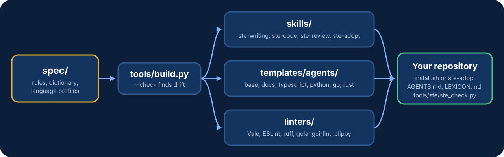

<p align="center">
  
</p>

# llm-airlines-standard

Aircraft maintenance manuals use a controlled language, so that no technician can misread an instruction.
That language is ASD-STE100 Simplified Technical English (STE).
This project applies the same discipline to LLM agents.

The project has three parts:

1. **STE for prose (W rules).** These rules apply to docs, commits, PRs, error messages, logs, and prompts that agents write.
2. **STE-C for code (C rules).** This port of STE applies to names, functions, files, errors, and logs.
3. **Tools.** The tools are Agent Skills, AGENTS.md templates, a checker, and linter configs.

## The code port in one table

| STE idea | STE-C rule |
|---|---|
| Use approved words, each with one meaning | Start each function with an approved verb. Each verb has one contract: `get` does no I/O, `fetch` uses the network (C3.1, C3.2). |
| Use one word for one meaning | Do not use `getUser`, `retrieveOrder`, and `obtainInvoice` in one codebase (C1.3). |
| Use 3 nouns or fewer in a cluster | Use 4 words or fewer in a name (C2.1). |
| Write 20 words or fewer in an instruction | Write 40 lines or fewer in a function (C5.1). |
| Write one topic per paragraph | Write one topic per file, in 200 lines of code or fewer (C5.7). |
| Put the condition first | Use guard clauses and early returns (C5.2). |
| Do not leave out words | Do not use magic numbers, implicit coercion, or positional booleans (C4.3). |
| Descriptive writing | Write no comments and no docstrings. The code explains itself (C6.1, C6.2). |
| Safety instructions | Put the risk in the name and give it a safe default: `deleteAllRows({ isConfirmed: false })` (C7.1, C7.2). |

The full rules are in `spec/writing/rules.md` and `spec/code/rules.md`.
The map of each STE section to its code rules is in `spec/code/mapping.md`.

## What is in this repository

| Path | Contents |
|---|---|
| `skills/ste-writing` | A skill to write and rewrite prose with STE |
| `skills/ste-code` | A skill to write code with STE-C |
| `skills/ste-review` | A skill to audit prose and code, with the `ste_check.py` checker |
| `skills/ste-adopt` | A skill to set up the standard in a repository |
| `templates/agents/` | Drop-in AGENTS.md files: `base`, `docs`, `typescript`, `python`, `go`, and `rust` |
| `templates/LEXICON.md` | The empty project dictionary |
| `linters/` | Configs for Vale, ESLint, ruff, golangci-lint, and clippy, and a git `commit-msg` hook |
| `spec/` | The rules, the dictionary, and the language profiles |
| `install.sh`, `tools/install.py` | The installer for the skills |
| `docs/images/` | The logo and the build diagram |

The build reads the rules in `spec/` and writes the skills, the templates, and the linter configs.
The installer and the `ste-adopt` skill put them in your repository.



## Install the skills

### The installer

The installer asks which skills you want and where to put them.
It needs Python 3.9 or later. Run it from the project where you want the skills.

With no clone, run this command:

```sh
curl -fsSL https://raw.githubusercontent.com/<owner>/llm-airlines-standard/main/install.sh | STE_REPOSITORY=<owner>/llm-airlines-standard bash
```

From a clone, run this command:

```sh
python3 path/to/llm-airlines-standard/tools/install.py
```

The installer shows two menus:

```text
Which skills do you want to install?
  1) ste-adopt: Set up STE (ASD-STE100 Simplified Technical English) and STE-C (its port to code) in a repository.
  2) ste-code: Write, refactor, or review source code with STE-C, the port of ASD-STE100 Simplified Technical English to code.
  3) ste-review: Audit prose or code against STE (the ASD-STE100 writing rules) and STE-C (the code port), and report each break with its rule ID.
  4) ste-writing: Write or rewrite prose with the ASD-STE100 Simplified Technical English rules, so that no reader can misread it.
Type numbers, or press Enter for 1, 2, 3, 4: 2 4
Where do you want to install them?
  1) Claude Code, for your user account (~/.claude/skills)
  2) Claude Code, for the current project (.claude/skills)
  3) Codex, Cursor, and other agents, for your user account (~/.agents/skills)
  4) Codex, Cursor, and other agents, for the current project (.agents/skills)
  5) Another folder (you type the path)
Type numbers, or press Enter for 1: 1 3
```

To install with no questions, give the skills and the targets:

```sh
python3 tools/install.py --skills ste-writing,ste-review --target claude-user --target agents-user
```

| Option | Meaning |
|---|---|
| `--list` | Show the skills and the targets, then stop. |
| `--skills a,b` | Install only these skills. Use `all` for every skill. |
| `--target KEY` | Install in a known folder: `claude-user`, `claude-project`, `agents-user`, or `agents-project`. |
| `--dir PATH` | Install in a different skills folder, such as `~/.gemini/skills`. |
| `--project PATH` | Use this project folder for the project targets. The default is the current folder. |
| `--dry-run` | Show the changes, and change no file. |
| `--force` | Replace a skill folder that has local changes. |

The installer does not replace a skill folder that has local changes, unless you give `--force` or answer "y".
It never replaces a folder that has no `SKILL.md` file.

To pipe the options through `curl`, put them after `bash -s --`:

```sh
curl -fsSL https://raw.githubusercontent.com/<owner>/llm-airlines-standard/main/install.sh | STE_REPOSITORY=<owner>/llm-airlines-standard bash -s -- --skills all --target claude-user
```

### Claude Code plugin

You can also install all four skills as one Claude Code plugin:

```text
/plugin marketplace add <owner>/llm-airlines-standard
/plugin install airlines-standard@llm-airlines-standard
```

For a local copy, give the path instead: `/plugin marketplace add ./llm-airlines-standard`.
The plugin adds a prefix to each skill name, such as `airlines-standard:ste-review`.

## Set up a repository

The fast way is the `ste-adopt` skill. Ask your agent: "Adopt the airline standard in this repository."

To set it up by hand, do these steps:

1. Copy `templates/agents/<profile>/AGENTS.md` to the root of the repository.
2. Write a `CLAUDE.md` file next to it that contains only the line `@AGENTS.md`.
3. Copy `templates/LEXICON.md` to the root of the repository.
4. Copy `skills/ste-review/scripts/` to `tools/ste/`.
5. Copy the linter configs for your languages from `linters/`.

## Run the checker

The checker needs Python 3.9 or later and no packages.

```sh
python3 tools/ste/ste_check.py prose README.md docs
python3 tools/ste/ste_check.py code src
python3 tools/ste/ste_check.py commit .git/COMMIT_EDITMSG
python3 tools/ste/ste_check.py lexicon src
```

Each finding has a rule ID, a severity, and a fix:

```text
src/billing.py:12:1: error C6.1: Remove this comment. Put the meaning in a name, a constant, or a type. Put the reason in the commit message.
```

The exit code is 1 when there is an error. Use `--strict` to fail on warnings too, and `--format json` to get data.

### pre-commit

This repository has hooks for the pre-commit framework:

```yaml
repos:
  - repo: https://github.com/<owner>/llm-airlines-standard
    rev: main
    hooks:
      - id: ste-prose
      - id: ste-code
      - id: ste-commit
```

## Change the standard

Read `AGENTS.md`. In short, do these steps:

1. Edit the source in `spec/`.
2. Run `python3 tools/build.py`.
3. Run `python3 -m unittest discover -s tests`.

## Sources

The rules paraphrase ASD-STE100. These sources describe the standard:

- [ASD-STE100 official site](https://www.asd-ste100.org/): the standard and its free download.
- [About ASD-STE100](https://asd-ste100.org/about_STE.html): the history and the purpose of the standard.
- [ASD: Simplified Technical English](https://asd-europe.org/standards-specifications/simplified-technical-english): the page of the organization that owns the standard.
- [ASD: Simplified Technical English, ASD-STE100 Issue 9](https://asd-europe.org/news-media/news-events/news/simplified-technical-english-asd-ste100-issue-9): the release of Issue 9 in January 2025.
- [tcworld: ASD-STE100 Issue 9, a standard for technical documentation](https://www.tcworld.info/news/asd-ste100-issue-9-setting-a-standard-for-technical-documentation): the changes in Issue 9, with 53 writing rules in 9 sections.
- [Term checker rules for ASD-STE100 Issue 9](https://simplified-english.co.uk/rules-ste9.html): the Issue 9 terms "technical noun" and "technical verb".

These sources set the format and the install folders of the skills:

- [Agent Skills](https://agentskills.io/): the open format of `SKILL.md`.
- [OpenAI Codex: Agent Skills](https://developers.openai.com/codex/skills): the `.agents/skills` folders.
- [Cursor: Agent Skills](https://cursor.com/docs/skills): the `.agents/skills` folders, and the Claude and Codex folders.

Other projects also turn STE into an agent skill:

- [danyuchn/asd-ste100-skill](https://github.com/danyuchn/asd-ste100-skill): an STE writing skill with the MIT license.
- The `writing-simplified-technical-english` skill in the PostHog plugin for Claude Code: an STE writing skill for agent prose.

This project copies no text from these projects.

## License and notice

The content of this project uses the MIT license.
ASD-STE100 is a trademark of ASD. This project has no link to ASD. Read `NOTICE.md`.
